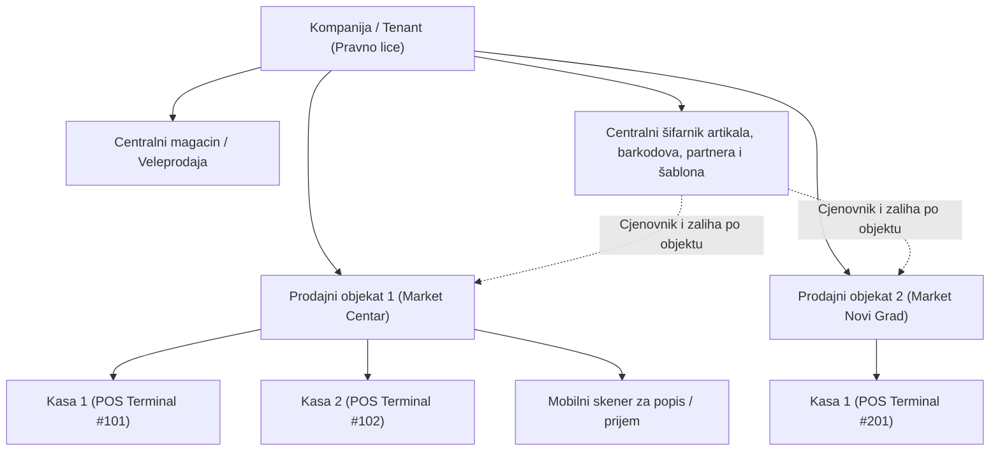
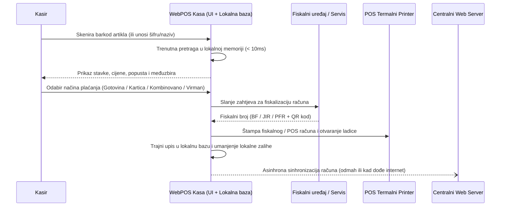

# Funkcionalna specifikacija: Hibridni WebPOS i ERP sistem nove generacije

> [!IMPORTANT]
> Ovaj dokument definiše kompletan opseg funkcionalnosti za **WebPOS** — ultra-brzi, višekorisnički i višeobjektni prodajni i robno-materijalni sistem prilagođen marketima s velikim prometom, s hibridnim režimom rada (**Web u oblaku + Desktop Offline-First aplikacija**).

---

## 1. Vizija i ključni ciljevi sistema

WebPOS je zamišljen kao SaaS / Cloud-first platforma u koju se korisnik prijavljuje putem web linka i korisničkog naloga, uz mogućnost **jednoklikne instalacije Desktop verzije** direktno iz web pretraživača ili korisničkog portala kako bi prodajno mjesto neometano radilo i bez internet konekcije.

### Ključni poslovni zahtjevi:
1. **Brzina i ergonomija za markete velikog prometa:** Rad na kasi u potpunosti prilagođen tastaturi (prečice bez upotrebe miša), ekranima osjetljivim na dodir (Touch POS) i brzim 1D/2D barkod skenerima (< 50 ms odziv pri skeniranju artikla).
2. **Više prodajnih objekata (Multi-store / Multi-location):** Svaki prodajni objekat (poslovna jedinica / maloprodaja / magacin) ima sopstvenu zalihu, sopstvene prodajne cijene, poreske stope i komercijalne uslove, uz centralizovan katalog artikala i šifarnike.
3. **Više kasa i više operatera istovremeno:** Neograničen broj aktivnih kasa po objektu bez ikakvog miješanja otvorenih računa, transakcija, smjena ili sekvenci brojeva računa.
4. **Hibridni Online/Offline rad:** Automatski prelazak na lokalnu bazu podataka u slučaju prekida interneta, bez prekida kucanja računa, te automatska pozadinska sinhronizacija čim se veza uspostavi.
5. **Kompletno robno-materijalno poslovanje:** Kalkulacije, nivelacije, prelokacije (međuskladišnice), zapisnici, predračuni, fakturisanje, narudžbe dobavljačima, normativi/sastavnice i mobilni popis robe.
6. **Fiskalizacija i štampa:** Direktna integracija s fiskalnim uređajima / servisima (e-Fiskalizacija / fiskalni printeri), brza štampa na termalnim POS printerima i dizajner šablona za štampu cijena/deklaracija za police i artikle.

---

## 2. Arhitektura poslovnih entiteta i hijerarhija

### 2.1. Organizacijska struktura
- **Pravno lice (Tenant):** Podaci o firmi, ID/PIB/JIB, PDV broj, žiro računi, logotip, globalna podešavanja.
- **Poslovna jedinica / Prodajni objekat:**
  - Tip objekta: *Maloprodajni objekat (Market)*, *Veleprodajni magacin*, *Proizvodni pogon / Kuhinja / Pekara*.
  - Zasebno stanje zaliha i zasebna prodajna cijena (MPC / VPC) za svaki artikal.
  - Zaseban cjenovnik, akcije i popusti (mogućnost globalnih akcija ili akcija samo za odabrani objekat).
- **Kasa (POS Terminal / Naplatni uređaj):**
  - Svaka kasa ima jedinstvenu oznaku (`POS-PJ01-K01`), sopstvenu lokalnu sekvencu računa i vezane periferije (POS printer, fiskalni uređaj, ladica za novac, kupčev displej, vaga).
  - Računi sa različitih kasa nikada ne dijele istu numeričku sekvencu bez prefiksa kase (`PJ01-K01-000001`, `PJ01-K02-000001`), čime je **100% eliminisano miješanje računa** čak i pri potpunom offline radu.

---

## 3. Korisničke uloge, operateri i smjene

### 3.1. Uloge i prava pristupa (RBAC)
| Uloga | Ključna ovlaštenja |
| :--- | :--- |
| **Super Administrator / Vlasnik** | Kreiranje objekata, kasa, operatera, uvid u sve izvještaje, globalne cijene i sistemska podešavanja. |
| **Menadžer objekta / Poslovođa** | Kalkulacije, nivelacije, prelokacije, zapisnici, narudžbe, štampa deklaracija, storniranje računa, pregled prometa svog objekta. |
| **Kasir / Operater na kasi** | Prijava na kasu (PIN / kartica / barkod bedž), izdavanje računa, uvid u cijenu i stanje, dnevni presjek smjene. Opciono ograničenje brisanja stavki ili davanja popusta bez PIN-a poslovođe. |
| **Magacioner / Popisivač** | Korištenje mobilnog interfejsa za popis robe, prijem robe (ulaz) i kreiranje prelokacija skeniranjem barkodova. |
| **Knjigovođa / Fakturista** | Veleprodajno fakturisanje, predračuni, knjižna odobrenja, izvoz za finansijsko knjigovodstvo i PDV evidencije. |

### 3.2. Rad sa više operatera i "Parkirani računi"
- **Brza promjena operatera:** Na jednoj kasi može biti prijavljeno više operatera (prebacivanje jednim tasterom ili skeniranjem operatorske kartice).
- **Paralelni / Parkirani računi (Hold / Park Bill):**
  - Ako kupac zaboravi novčanik ili traži dodatni artikal, kasir jednim tasterom (`F4 - Parkiraj račun`) stavlja račun na čekanje i odmah uslužuje sljedećeg kupca.
  - Neograničen broj parkiranih računa po kasi, uz mogućnost preuzimanja računa i na drugoj kasi u istom objektu (kada je mreža dostupna).
- **Upravljanje smjenama i blagajnom:**
  - Unos početnog pologa (depozita/sitnog novca) na početku smjene.
  - Evidencija službenog ulaza/izlaza gotovine iz ladice.
  - Predaja pazara po operateru ili po kasi na kraju smjene (slijepi popis gotovine vs. očekivani promet po vrstama plaćanja).

---

## 4. Šifarnici, Artikli i Normativi (Roba sa sastavnicom)

### 4.1. Šifarnik artikala
- **Osnovni podaci:** Interna šifra, naziv artikla, skraćeni naziv za POS printer/fiskalni uređaj, jedinica mjere (`kom`, `kg`, `l`, `m`, `pak`), poreska grupa / PDV stopa, proizvođač, robna grupa / kategorija, podkategorija.
- **Višestruki barkodovi po artiklu:**
  - Jedan artikal može imati neograničen broj EAN-8 / EAN-13 / Code128 barkodova (npr. različita pakovanja ili različite serije dobavljača).
  - **Transportna pakovanja (Baksa / Paket / Paleta):** Poseban barkod za transportno pakovanje koji automatski dodaje odgovarajuću količinu (npr. skeniranje barkoda paketa automatski kuca `24 x Pojedinačni artikal` ili paket po definisanoj cijeni).
  - **Težinski / Vaga barkodovi (Prefiks 20–29):** Automatsko parsiranje barkodova sa mesoreznica i vaga za voće/povrće (prepoznavanje šifre artikla + težine u gramima ili iznosa u valuti).
- **Podaci za deklaracije:** Zemlja porijekla, uvoznik, dobavljač, sastav, rok trajanja, jedinična cijena po kg/l (za automatski izračun cijene po mjernoj jedinici na polici, npr. `1 kg = 12,50 KM` za pakovanje od `400 g`).

### 4.2. Cijene po prodajnim objektima
- Svaki objekat ima sopstvenu **Nabavnu cijenu (NC)**, **Veleprodajnu cijenu (VPC)** i **Maloprodajnu cijenu (MPC)**.
- Mogućnost centralnog definisanja preporučene MPC uz automatsko generisanje **Nivelacije** u objektima u kojima se cijena mijenja.
- **Akcijski cjenovnici i Happy Hour:** Vremenski ograničene akcije (od–do datuma/sata) za pojedinačni objekat ili grupu objekata, količinski popusti ("Kupi 3, plati 2", rabat na količinu).

### 4.3. Roba sa normativom (Sastavnice / Proizvodnja / Gastro / Pekara)
- **Tipovi artikala:**
  1. *Standardni trgovački artikal (Roba)*
  2. *Usluga* (ne skida zalihu)
  3. *Složeni artikal sa normativom (Proizvod / Jelo / Poklon-korpa / Pekarski proizvod)*
  4. *Repromaterijal / Sirovina*
- **Način rada normativa (2 podržana modela po artiklu):**
  - **Model A — Automatsko razduženje pri prodaji (Backflushing):** Prodajom 1 komada složenog artikla na kasi (npr. sendvič, kafa s mlijekom, poklon-paket), sistem automatski u pozadini skida sa stanja pripadajuće količine repromaterijala prema definisanom normativu (npr. `0.15 kg peciva`, `0.08 kg šunke`, `1 kom ambalaže`).
  - **Model B — Interna proizvodnja / Radni nalog:** U objektu (npr. pekara ili gastro odjel u marketu) kreira se dokument *Interna proizvodnja*, koji na osnovu normativa razdužuje sirovine, a zadužuje gotov proizvod na stanje maloprodaje.
- Podrška za **višeslojne (ugniježđene) normative** (poluproizvod unutar gotovog proizvoda) i definisanje procenta kala/otpada pri pripremi.

---

## 5. POS Kasa (Maloprodajni modul)

### 5.1. Funkcionalnosti ekrana kase
- **Ultra-brzi unos stavki:**
  - Skeniranje barkoda u bilo kom trenutku (fokus je uvijek inteligentno vezan za unos barkoda).
  - Brzo množenje količine (`5 * [Skeniranje barkoda]` ili taster `*` za promjenu količine).
  - Pretraga po dijelu naziva, šifri ili kataloškom broju (instant fuzzy search).
  - Brze tipke (Grid sa slikama / kategorijama) za artikle bez barkoda (voće, povrće, peciva, kese).
- **Vrste plaćanja:**
  - Gotovina (sa automatskim izračunom kusura).
  - Platne kartice (mogućnost direktne veze sa POS terminalom banke ili ručna potvrda).
  - Kombinovano plaćanje (npr. dio gotovina, dio kartica ili poklon-bon).
  - Virman / Faktura na kasi (identifikacija pravnog lica / JIB / PIB direktno na kasi — B2B fiskalni račun).
  - Odgođeno plaćanje / Veresija / Interni kredit za ugovorene kupce sa praćenjem limita.
- **Reklamacije i storniranje:**
  - Brzo storniranje računa / povrat robe referenciranjem originalnog broja fiskalnog računa (skeniranjem QR koda ili barkoda sa računa).
  - Automatski povrat zalihe na stanje objekta i štampa reklamiranog (storno) fiskalnog računa.

---

## 6. Robno-materijalno poslovanje i dokumenti

Svi dokumenti podržavaju statuse: **U pripremi (Draft)** -> **Zaključan / Proknjižen (Posted)** -> **Storniran (Voided)**, uz punu revizionu istoriju (ko je kreirao, ko izmijenio, kada je proknjiženo).

### 6.1. Ulaz robe / Kalkulacija cijena (Prijemnica - Kalkulacija)
- Unos ulazne fakture dobavljača ili otpremnice.
- Stavke kalkulacije: Količina, Fakturna cijena, Rabat dobavljača (%), Zavisni troškovi nabavke (transport, carina, špedicija — raspodjela po vrijednosti, količini ili težini), Nabavna cijena, Marža (% ili iznos), PDV, Prodajna cijena sa PDV-om (MPC).
- **Automatska detekcija promjene cijene:** Ako se nova MPC u kalkulaciji razlikuje od postojeće MPC u tom objektu za zatečenu zalihu, sistem **automatski generiše Nivelaciju cijena** za zatečenu količinu na skladištu i stavlja izmijenjene artikle u red za **štampu novih deklaracija/cijena za police**.

### 6.2. Nivelacije cijena (Zapisnik o promjeni cijene)
- Ručna ili automatska promjena prodajne cijene za jedan artikal, grupu artikala ili cijeli objekat.
- Sistem u trenutku knjiženja očitava tačnu zatečenu zalihu u objektu, obračunava razliku u cijeni, razlici u marži i ukalkulisanom PDV-u (povećanje ili smanjenje vrijednosti robe).
- Zakonski propisan ispis **Zapisnika o promjeni cijena (Nivelacije)** spremnog za knjigovodstvo i inspekciju.
- Jednim klikom iz nivelacije: *"Štampaj nove cijene za police za sve artikle iz ove nivelacije"*.

### 6.3. Prelokacije (Međuskladišnice / Interni prenos između objekata)
- Prenos robe iz **Objekta A (Izdavalac)** u **Objekat B (Primalac)**.
- **Dvosmjerna kontrola (Izlaz -> Ulaz):**
  1. Objekat A kreira i zaključuje *Međuskladišnicu - Izlaz* (skida robu sa svog stanja).
  2. Objekat B vidi dokument u statusu *"Roba u tranzitu / Čeka prijem"* i potvrđuje prijem (ili skenira pristiglu robu mobilnim skenerom radi kontrole slaganja).
  3. **Automatsko usklađivanje cijena pri prelokaciji:** Pošto Objekat A i Objekat B mogu imati različite prodajne cijene za isti artikal, sistem automatski prenosi robu po nabavnoj cijeni, a u Objektu B zadužuje robu po važećoj MPC Objekta B (uz automatski obračun razlike u marži i PDV-u).

### 6.4. Zapisnici (Kalo, rastur, kvar i lom / Otpis / Višak / Manjak)
- Podržane vrste zapisnika:
  - **Zapisnik o kalu, rasturu, kvaru i lomu (KRKL)** — s praćenjem zakonski neoporezivog procenta kala i obračunom PDV-a na prekomjerni otpis.
  - **Zapisnik o oštećenju / isteku roka trajanja robe.**
  - **Zapisnik o popisnom višku i manjku** (automatski generisan nakon završetka popisa).
  - **Zapisnik o povratu robe dobavljaču (Knjižno odobrenje / Povratnica).**
- Štampa zvaničnog zapisnika sa mjestom za potpise članova komisije.

### 6.5. Narudžbe robe (Narudžbenice dobavljačima i Trebovanja)
- **Trebovanje iz prodajnog objekta:** Poslovođa marketa šalje trebovanje prema centralnom magacinu.
- **Narudžbenica dobavljaču:**
  - Ručno kreiranje ili **automatski prijedlog narudžbe** na osnovu minimalnih zaliha (`min_stock`) i prosječne dnevne prodaje u proteklih $N$ dana po objektu.
  - Slanje narudžbenice dobavljaču direktno na e-mail (PDF / Excel / EDI XML format).
  - Pretvaranje narudžbenice u ulaznu kalkulaciju jednim klikom po pristizanju robe.

### 6.6. Predračuni (Ponude) i Fakturisanje (Veleprodaja i B2B)
- **Predračuni / Ponude:** Kreiranje ponuda za kupce s rokom važenja, opcijom rezervacije zaliha ili bez uticaja na zalihu.
- **Jedan klik: Predračun -> Faktura / Otpremnica ili Fiskalni račun:** Automatsko pretvaranje plaćene ponude u konačnu fakturu uz skidanje sa stanja.
- **Veleprodajne fakture i Otpremnice:**
  - Podrška za rabatne skale po kupcu, valutu plaćanja, praćenje dospijeća i blokadu kupaca van valute/limita.
  - Fiskalizacija veleprodajnih i maloprodajnih B2B faktura u skladu sa lokalnim propisima.

---

## 7. Rad s barkod skenerima i Mobilni popis robe

### 7.1. Podrška za barkod skenere na kasi i u backoffice-u
- Podrška za sve **USB HID (Keyboard Wedge)**, **USB COM / Serial** i **Bluetooth / Bežične 1D i 2D** skenere bez potrebe za specijalnim drajverima.
- Pametni detektor brzine unosa (razlikuje skeniranje barkoda od ručnog kucanja na tastaturi, tako da skener radi čak i kada kursor nije u polju za pretragu).

### 7.2. Mobilni popis robe (Inventure) i Mobilni prijem
- Poseban, optimizovan **Mobilni PWA / Android modul** za namjenske industrijske mobilne terminale (Zebra, Honeywell, CipherLab, Datalogic sa ugrađenim laserskim/2D skenerom) kao i za obične pametne telefone (skeniranje kamerom ili spojenim Bluetooth skenerom).
- **Tok popisa robe (Inventure):**
  1. Menadžer otvara dokument **Popis robe** za odabrani objekat (kompletan popis ili parcijalni popis po robnoj grupi/polici).
  2. **Više popisivača istovremeno** skenira robu svojim mobilnim uređajima u istom objektu.
  3. Svako skeniranje prikazuje naziv artikla, jedinicu mjere i zvučnu/vizuelnu potvrdu (uz upozorenje ako barkod ne postoji u šifarniku).
  4. Podrška za **Offline popis** u dijelovima magacina ili hladnjača bez Wi-Fi signala, sa trenutnim slanjem popisanih stavki čim uređaj uhvati mrežu.
  5. Po završetku skeniranja, sistem sabira popisane količine svih uređaja, upoređuje ih sa knjigovodstvenim stanjem u trenutku presjeka i automatski kreira **Popisnu listu**, **Zapisnik o višku** i **Zapisnik o manjku**.

---

## 8. Deklaracije i cijene za police sa šablonima (Label & Shelf-Edge Designer)

### 8.1. Vizuelni dizajner šablona (Template Studio)
Korisnik u web aplikaciji ima ugrađen **Drag-and-Drop dizajner šablona** za cijene i deklaracije:
- **Vrste šablona:**
  - **Cijene za police (Shelf-edge labels):** Standardne dimenzije (npr. `38x25mm`, `50x30mm`, `60x40mm`) za termalne printere etiketa (Zebra, Bixolon, TSC, Xprinter) ili ispis na **A4 papir / perforirane kartone** (npr. 21, 24 ili 32 cijene po A4 listu).
  - **Akcijske cijene za police:** Šablon sa istaknutom **Starom (prekriženom) cijenom**, **Novom akcijskom cijenom** i procentom uštede (`-25%`), te najnižom cijenom u prethodnih 30 dana (usklađeno sa Zakonom o zaštiti potrošača).
  - **Deklaracije o proizvodu (etikete za lijepljenje na artikle):** Sadrže naziv artikla, sastav, uvoznika, zemlju porijekla, datum pakovanja / rok trajanja, lot i barkod.
  - **Etikete za artikle bez fabričkog barkoda:** Automatsko generisanje internog EAN-13 barkoda i štampa etikete za lijepljenje.
- **Automatski izračun jedinične cijene (Cijena po kg / l / m):**
  - Ako artikal ima definisanu neto masu/zapreminu (npr. `Čokolada 80g` po cijeni `2,00`), šablon automatski ispisuje i zakonski obaveznu informaciju: `1 kg = 25,00`.

### 8.2. Red za štampu cijena (Print Queue)
- Cijene se mogu štampati:
  - Automatski iz **Kalkulacije** ili **Nivelacije** (samo artikli kojima se promijenila cijena u tom objektu).
  - Skeniranjem police pomoću **mobilnog barkod skenera** (*"Provjera cijena na polici"*: radnik skenira redom artikle na polici, uređaj odmah upozorava ako cijena u sistemu ne odgovara i dodaje artikal u red za štampu cijena).
  - Ručnim odabirom artikala ili cijele kategorije iz šifarnika.

---

## 9. Fiskalizacija i POS štampa

- **Modularni fiskalni adapter (Local Fiscal Bridge):**
  - Arhitektura podržava različite fiskalne sisteme u regiji putem konfigurabilnog drajvera po prodajnom objektu:
    - **FBiH / RS (BiH):** Komunikacija sa fiskalnim uređajima / printerima (Tremol, Datecs, Tring, Mikroelektronika, HCP) i novom OFS / ESIR e-Fiskalizacijom (PFR/LPFR).
    - **Srbija (eFiskalizacija):** ESIR -> L-PFR / V-PFR sa štampom QR koda na običnom termalnom POS printeru.
    - **Hrvatska / Crna Gora:** XML/SOAP potpisivanje digitalnim certifikatom (JIR/ZKI ili IKOF/JIKR) i štampa QR koda.
- **POS štampa računa:**
  - Direktna, trenutna štampa putem ESC/POS protokola (USB, LAN/Ethernet ili Serial) bez iskakanja sporog browser Print dijaloga (zahvaljujući Desktop aplikaciji / lokalnom servisu).
  - Podrška za štampu predračuna, kopija računa, smjenskih izvještaja i otvaranje ladice za novac (`ESC p` komanda).

---

## 10. Hibridni rad (Web + Desktop Offline) i Sinhronizacija

### 10.1. Iskustvo prijave i instalacije
1. Korisnik dobija **Web link** (npr. `https://app.webpos.ba`) i pristupne podatke.
2. Kada se prijavi u web pretraživaču, ima pristup kompletnom sistemu (backoffice, izvještaji, šifarnici, web kasa).
3. Unutar web interfejsa nalazi se dugme **"Instaliraj Desktop POS za rad bez interneta"** (dostupno kao lagana nativna Desktop aplikacija za Windows/Linux/macOS zasnovana na Tauri/Electron tehnologiji ili PWA sa lokalnim servisom).
4. Prilikom prve prijave na Desktop aplikaciji, kasa preuzima kompaktan lokalni snimak šifarnika artikala, barkodova i cijena za taj prodajni objekat.

### 10.2. Ponašanje sa internetom i bez interneta
| Stanje mreže | Način rada |
| :--- | :--- |
| **Online (Ima interneta)** | Sve promjene cijena, novi artikli, prelokacije i nivelacije sa weba stižu na kasu u realnom vremenu (WebSockets / SSE), a izdati računi se odmah šalju u centralnu bazu u oblaku. |
| **Offline (Nema interneta)** | Aplikacija bez ikakvog prekida ili poruke o grešci čita artikle i cijene iz **lokalne baze na računaru**, fiskalizuje i štampa račune na lokalnom printeru, te smješta transakcije u lokalni **Outbox red za sinhronizaciju**. |
| **Povratak interneta (Auto-Sync)** | Pozadinski proces automatski šalje sve offline račune i promjene u centralnu web bazu u malim paketima (batch delta sync) uz kriptografski ključ idempotentnosti, garantujući da nijedan račun neće biti izgubljen niti dupliran. |

---

## 11. Izvještaji i Analitika u realnom vremenu

- **Nadzorna ploča (Dashboard) uživo:** Trenutni promet po objektima, kasama i operaterima u realnom vremenu, broj izdatih računa, prosječna korpa i najprodavaniji artikli.
- **Knjigovodstveni zakonski izvještaji:**
  - **TKP / KEP knjiga** (Trgovačka knjiga na malo / Knjiga evidencije prometa i robe) po svakom objektu.
  - Pregled ulaza, izlaza, nivelacija i zaliha po nabavnim i prodajnim cijenama.
  - Rekapitulacija PDV-a po stopama i vrstama plaćanja.
- **Komercijalni izvještaji:**
  - Ostvarena razlika u cijeni (RUC / Marža) po artiklu, kategoriji, dobavljaču i objektu.
  - Lager lista sa upozorenjem na artikle ispod minimalne zalihe i artikle bez prometa (mrtva zaliha).
