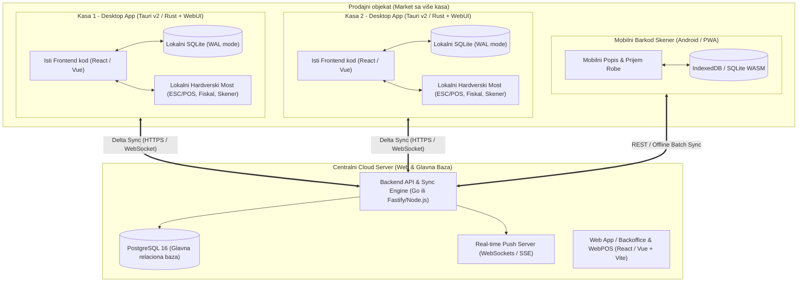
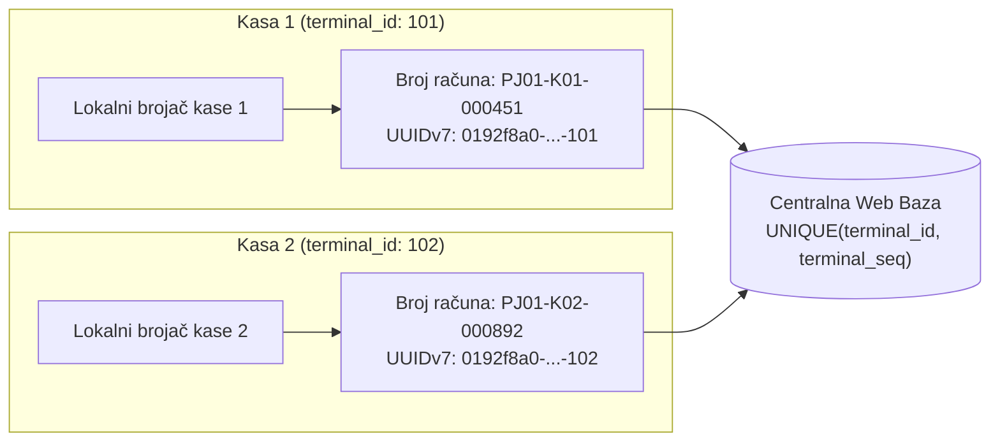
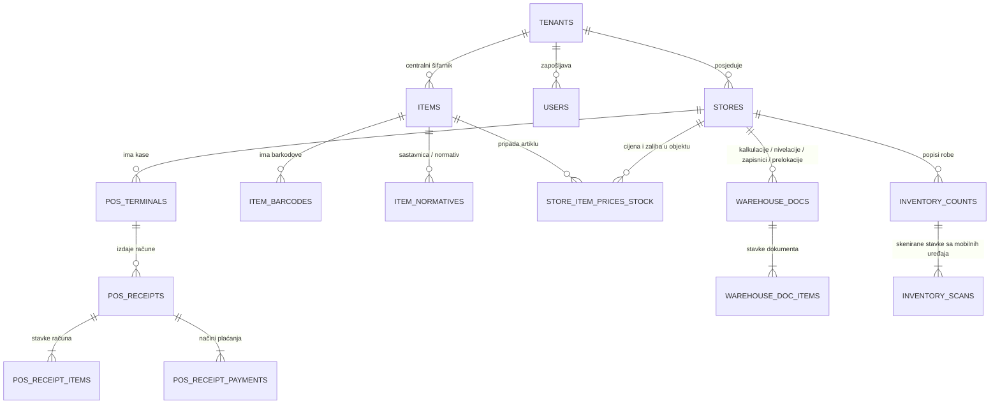

# Tehnička specifikacija: Hibridni WebPOS (Cloud + Offline-First Desktop)

> [!IMPORTANT]
> Glavni arhitekturni fokus ove tehničke specifikacije jeste **minimalna potrošnja sistemskih resursa** (i na cloud serveru i na lokalnim POS računarima), **trenutni odziv (< 10 ms)** pri kucanju računa u marketima velikog prometa, **100% izolacija sekvenci računa između kasa**, te **besprijekorna dvosmjerna sinhronizacija** između centralne web baze i lokalne desktop baze.

---

## 1. Arhitekturni pregled i tehnološki stog (Tech Stack)

Da bi sistem radio ultra-brzo i na starijim POS računarima sa 4 GB RAM-a, kao i na povoljnom Cloud VPS serveru (npr. 2 vCPU / 4 GB RAM za desetine marketa), odabrana je arhitektura bez teških runtime okruženja:



### 1.1. Zašto ova kombinacija troši minimalno resursa?

| Sloj sistema | Preporučena tehnologija | Obrazloženje i potrošnja resursa |
| :--- | :--- | :--- |
| **Centralna Web Baza** | **PostgreSQL 16** (uz pažljivo indeksiranje i particionisanje stavki računa) | Industrijski standard za finansijske i robne transakcije (ACID), radi izuzetno stabilno već na **512 MB – 1 GB RAM-a**, podržava parcijalne indekse i `BIGINT`/`UUIDv7` ključeve. |
| **Lokalna Baza na Kasi** | **SQLite 3 (u `WAL` — Write-Ahead Logging režimu)** | Nema posebnog db servisa koji troši RAM u pozadini. Baza je jedan fajl na disku (~20–50 MB za 100.000 artikala), čitanje barkoda traje **< 1 ms**, troši **< 15 MB RAM-a** i otporna je na nestanak struje (`PRAGMA synchronous = NORMAL; PRAGMA journal_mode = WAL;`). |
| **Desktop Aplikacija** | **Tauri v2 (Rust jezgro + sistemski WebView)** | Za razliku od Electrona koji troši 300–600 MB RAM-a i instalacija je >150 MB, **Tauri instalacija je ~8 MB**, koristi ~40 MB RAM-a, dijeli **100% isti UI kod** kao i Web aplikacija, i ima direktan pristup USB/Serial/LAN portovima za POS printere i fiskalne uređaje. |
| **Backend Server** | **Go (Golang)** ili **Node.js (Fastify / TypeScript)** | Kompiliran (Go) ili nisko-režijski asinhroni server sposoban da opsluži >10.000 zahtjeva u sekundi na jednom procesorskom jezgru uz < 50 MB RAM-a. |
| **Frontend (Web + Kasa + Mobilni)** | **TypeScript + React (ili Vue 3) + TailwindCSS** | Jedna baza koda (Single Codebase) za Web pristup, Desktop kasu i Mobilni popisivač robe. |

> [!TIP]
> **Kako funkcioniše instalacija Desktop verzije direktno sa Weba?**
> Kada se korisnik uloguje putem web linka (`https://pos.domena.com`), u gornjem meniju ima dugme **"Preuzmi Desktop Kasu"**. Klikom na dugme preuzima se lagani Tauri instaler (~8 MB) sa već ugrađenim konfiguracionim tokenom ili se pri pokretanju automatski povezuje putem jednokratnog koda sa web sesije, preuzima inicijalnu SQLite bazu za taj prodajni objekat i kreira ikonu na Desktopu.

---

## 2. Kako radi Hibridni Online/Offline Režim i Sinhronizacija

### 2.1. Pravilo čitanja i pisanja (Local-First / Hybrid Read-Write)
1. **U Web pretraživaču (Online Web režim):**
   - Korisnik radi direktno nad centralnom bazom putem REST/WebSocket API-ja (uz keširanje kataloga artikala u `IndexedDB` radi trenutne pretrage barkodova).
2. **U Desktop aplikaciji (Hibridni Online/Offline režim):**
   - **Pretraga artikala i kucanje računa** uvijek čita iz lokalne **SQLite** baze u RAM kešu — zato kasa nikad ne "zastajkuje" čak ni kada internet nakratko zatrokira u sred gužve na kasi.
   - **Kada IMA interneta:** Svaki zaključeni račun se u istoj milisekundi upisuje u lokalni SQLite i odmah šalje (`POST /api/v1/sync/receipts`) na centralni server, dok promjene cijena, novi artikli i nivelacije sa servera stižu u sekundi preko WebSocket kanala i ažuriraju lokalni SQLite.
   - **Kada NEMA interneta:** Kasa detektuje gubitak konekcije (indikator u uglu prelazi iz zelene u narandžastu boju *"Offline režim — računi se čuvaju lokalno"*). Kasa normalno fiskalizuje, štampa račune i upisuje ih u lokalnu tabelu `sync_outbox`.
   - **Kada DOĐE internet:** Pozadinski `SyncWorker` čita stavke iz `sync_outbox` po FIFO redoslijedu i šalje ih u paketima (npr. po 50 računa) na centralni server.

### 2.2. Kako garantujemo da se računi sa više kasa NIKADA ne pomiješaju?



Miješanje računa između kasa je matematički onemogućeno kroz **3 mehanizma**:
1. **Vremenski sortirani globalno jedinstveni identifikator (`UUIDv7`):** Svaki račun, stavka i smjena dobijaju `UUIDv7` generisan na samoj kasi u trenutku kreiranja.
2. **Kompozitni broj računa vezan za kasu (`store_code` + `terminal_code` + `fiscal_year` + `terminal_seq`):**
   - Kasa 1 generiše brojeve: `M01-K1-2026-000001`, `M01-K1-2026-000002`...
   - Kasa 2 generiše brojeve: `M01-K2-2026-000001`, `M01-K2-2026-000002`...
   - Nijedna kasa ne zavisi od brojača druge kase niti od centralnog servera da bi izdala račun.
3. **Izolacija zaliha putem tabele pokreta (`stock_movements` — Append-Only Ledger):**
   - Kase **ne prepisuju** polje `trenutna_kolicina = 10` (što bi izazvalo problem ako dvije kase istovremeno prodaju isti artikal offline).
   - Umjesto toga, svaka kasa šalje **promjenu (deltu)**: `količina: -1` sa jedinstvenim `idempotency_key` (ID računa + ID stavke). Centralna baza atomski sabira sve ulaze i izlaze (`current_qty = current_qty - 1`), tako da je stanje uvijek 100% tačno bez obzira kojim redoslijedom kase sinhronizuju podatke.

---

## 3. Model baze podataka (ER Dijagram i SQL Šema)

Baza podataka je dizajnirana tako da bude **kompaktna, visoko normalizovana za šifarnike**, a **optimizovana za brzo čitanje cijena i zaliha po objektu**.

### 3.1. ER Dijagram ključnih entiteta



### 3.2. SQL Šema (PostgreSQL / Kompatibilno sa SQLite)

```sql
-- 1. ORGANIZACIJA: Kompanije, Prodajni objekti, Kase i Operateri
CREATE TABLE tenants (
    id UUID PRIMARY KEY,
    name VARCHAR(150) NOT NULL,
    tax_number VARCHAR(32) NOT NULL,       -- JIB / PIB / OIB
    vat_number VARCHAR(32),                -- PDV broj
    address TEXT,
    settings JSONB DEFAULT '{}'::jsonb,
    created_at TIMESTAMPTZ NOT NULL DEFAULT NOW()
);

CREATE TABLE stores (
    id UUID PRIMARY KEY,
    tenant_id UUID NOT NULL REFERENCES tenants(id),
    code VARCHAR(16) NOT NULL,             -- npr. 'PJ01', 'MARKET-CENTAR'
    name VARCHAR(120) NOT NULL,
    store_type VARCHAR(20) NOT NULL,       -- 'RETAIL', 'WHOLESALE', 'PRODUCTION'
    address TEXT,
    is_active BOOLEAN NOT NULL DEFAULT TRUE,
    UNIQUE (tenant_id, code)
);

CREATE TABLE pos_terminals (
    id UUID PRIMARY KEY,
    store_id UUID NOT NULL REFERENCES stores(id),
    code VARCHAR(16) NOT NULL,             -- npr. 'K1', 'K2'
    name VARCHAR(80) NOT NULL,
    last_receipt_seq BIGINT NOT NULL DEFAULT 0,
    last_sync_version BIGINT NOT NULL DEFAULT 0,
    fiscal_config JSONB DEFAULT '{}'::jsonb,
    printer_config JSONB DEFAULT '{}'::jsonb,
    is_active BOOLEAN NOT NULL DEFAULT TRUE,
    UNIQUE (store_id, code)
);

CREATE TABLE users (
    id UUID PRIMARY KEY,
    tenant_id UUID NOT NULL REFERENCES tenants(id),
    username VARCHAR(64) NOT NULL,
    password_hash TEXT NOT NULL,
    cashier_pin_hash TEXT,                 -- Brzi PIN za prebacivanje operatera na kasi
    badge_barcode VARCHAR(64),             -- Barkod kartica operatera
    full_name VARCHAR(120) NOT NULL,
    role VARCHAR(32) NOT NULL,             -- 'ADMIN', 'MANAGER', 'CASHIER', 'WAREHOUSE', 'ACCOUNTANT'
    allowed_store_ids UUID[] DEFAULT '{}',
    is_active BOOLEAN NOT NULL DEFAULT TRUE,
    UNIQUE (tenant_id, username)
);

-- 2. ŠIFARNIK ARTIKALA, BARKODOVA I NORMATIVA
CREATE TABLE tax_rates (
    id UUID PRIMARY KEY,
    tenant_id UUID NOT NULL REFERENCES tenants(id),
    code VARCHAR(10) NOT NULL,             -- npr. 'E' (17%), 'A' (0%), 'PDV20'
    name VARCHAR(50) NOT NULL,
    rate NUMERIC(5,2) NOT NULL             -- npr. 17.00
);

CREATE TABLE items (
    id UUID PRIMARY KEY,
    tenant_id UUID NOT NULL REFERENCES tenants(id),
    sku VARCHAR(32) NOT NULL,              -- Interna šifra artikla
    name VARCHAR(200) NOT NULL,
    short_name VARCHAR(64),                -- Skraćeni naziv za fiskalni printer
    item_type VARCHAR(20) NOT NULL DEFAULT 'GOODS', -- 'GOODS', 'SERVICE', 'COMPOSITE', 'RAW_MATERIAL'
    normative_mode VARCHAR(20) DEFAULT 'NONE',      -- 'NONE', 'ON_SALE_BACKFLUSH', 'PRODUCTION_ORDER'
    uom VARCHAR(12) NOT NULL DEFAULT 'kom',         -- 'kom', 'kg', 'l', 'm'
    net_content_qty NUMERIC(10,4),                  -- npr. 0.400 (za 400g -> automatska cijena po 1kg na polici)
    net_content_uom VARCHAR(12),                    -- npr. 'kg' ili 'l'
    tax_rate_id UUID NOT NULL REFERENCES tax_rates(id),
    category_id UUID,
    declaration_data JSONB DEFAULT '{}'::jsonb,     -- Zemlja porijekla, uvoznik, sastav, rok
    is_weighable BOOLEAN NOT NULL DEFAULT FALSE,    -- Vaga artikal (prefiks 20-29)
    is_active BOOLEAN NOT NULL DEFAULT TRUE,
    sync_version BIGINT NOT NULL DEFAULT 1,         -- Inkrementalna verzija za Delta Sync
    updated_at TIMESTAMPTZ NOT NULL DEFAULT NOW(),
    UNIQUE (tenant_id, sku)
);

CREATE TABLE item_barcodes (
    id UUID PRIMARY KEY,
    tenant_id UUID NOT NULL REFERENCES tenants(id),
    item_id UUID NOT NULL REFERENCES items(id) ON DELETE CASCADE,
    barcode VARCHAR(64) NOT NULL,
    pack_multiplier NUMERIC(12,4) NOT NULL DEFAULT 1.0000, -- 1 za komad, npr. 24 za transportni paket
    sync_version BIGINT NOT NULL DEFAULT 1,
    UNIQUE (tenant_id, barcode)
);
CREATE INDEX idx_item_barcodes_lookup ON item_barcodes(tenant_id, barcode);

-- Roba sa normativom (Sastavnica)
CREATE TABLE item_normatives (
    id UUID PRIMARY KEY,
    parent_item_id UUID NOT NULL REFERENCES items(id) ON DELETE CASCADE,
    component_item_id UUID NOT NULL REFERENCES items(id),
    quantity NUMERIC(12,4) NOT NULL,                -- Potrebna količina sirovine za 1 JM gotovog proizvoda
    waste_pct NUMERIC(5,2) NOT NULL DEFAULT 0.00,   -- Procenat kala u pripremi
    UNIQUE (parent_item_id, component_item_id)
);

-- 3. CIJENE I ZALIHE PO PRODAJNOM OBJEKTU (Svaki objekat ima svoje cijene i zalihu!)
CREATE TABLE store_item_state (
    store_id UUID NOT NULL REFERENCES stores(id),
    item_id UUID NOT NULL REFERENCES items(id),
    purchase_price NUMERIC(14,4) NOT NULL DEFAULT 0, -- Zadnja nabavna cijena (NC) u tom objektu
    wholesale_price NUMERIC(14,4) NOT NULL DEFAULT 0,-- Veleprodajna cijena bez PDV-a (VPC)
    retail_price NUMERIC(14,4) NOT NULL DEFAULT 0,   -- Maloprodajna cijena sa PDV-om (MPC)
    promo_price NUMERIC(14,4),                       -- Akcijska cijena u tom objektu
    promo_valid_until TIMESTAMPTZ,
    lowest_price_30d NUMERIC(14,4),                  -- Najniža cijena u zadnjih 30 dana (za deklaracije)
    stock_qty NUMERIC(14,4) NOT NULL DEFAULT 0,      -- Trenutna zaliha u tom objektu
    min_stock_qty NUMERIC(14,4) NOT NULL DEFAULT 0,  -- Minimalna zaliha za alarm/narudžbenicu
    shelf_location VARCHAR(32),                      -- Oznaka police / reda u marketu
    needs_label_print BOOLEAN NOT NULL DEFAULT FALSE,-- Indikator da treba odštampati novu cijenu za policu
    sync_version BIGINT NOT NULL DEFAULT 1,
    updated_at TIMESTAMPTZ NOT NULL DEFAULT NOW(),
    PRIMARY KEY (store_id, item_id)
);
CREATE INDEX idx_store_item_sync ON store_item_state(store_id, sync_version);

-- 4. POS RAČUNI I STAVKE (Bez mogućnosti kolizije između kasa)
CREATE TABLE pos_receipts (
    id UUID PRIMARY KEY,                             -- UUIDv7 generisan na kasi
    tenant_id UUID NOT NULL REFERENCES tenants(id),
    store_id UUID NOT NULL REFERENCES stores(id),
    terminal_id UUID NOT NULL REFERENCES pos_terminals(id),
    cashier_id UUID NOT NULL REFERENCES users(id),
    shift_id UUID,
    terminal_seq BIGINT NOT NULL,                    -- Redni broj računa na toj konkretnoj kasi
    receipt_number VARCHAR(40) NOT NULL,             -- npr. 'PJ01-K1-2026-000125'
    receipt_type VARCHAR(16) NOT NULL DEFAULT 'SALE',-- 'SALE' (Prodaja), 'REFUND' (Storno/Reklamacija)
    ref_receipt_id UUID REFERENCES pos_receipts(id), -- Veza na originalni račun kod reklamacije
    partner_id UUID,                                 -- Za B2B / Faktura račun na kasi
    subtotal_net NUMERIC(14,2) NOT NULL,
    discount_amount NUMERIC(14,2) NOT NULL DEFAULT 0,
    tax_amount NUMERIC(14,2) NOT NULL,
    total_amount NUMERIC(14,2) NOT NULL,
    fiscal_number VARCHAR(64),                       -- Broj fiskalnog računa (BF / PFR / JIR)
    fiscal_qr_data TEXT,
    issued_offline BOOLEAN NOT NULL DEFAULT FALSE,   -- Da li je račun izdat dok nije bilo interneta
    issued_at TIMESTAMPTZ NOT NULL,                  -- Tačno vrijeme izdavanja na kasi
    synced_at TIMESTAMPTZ,
    UNIQUE (terminal_id, terminal_seq),
    UNIQUE (tenant_id, receipt_number)
);

CREATE TABLE pos_receipt_items (
    id UUID PRIMARY KEY,
    receipt_id UUID NOT NULL REFERENCES pos_receipts(id) ON DELETE CASCADE,
    item_id UUID NOT NULL REFERENCES items(id),
    scanned_barcode VARCHAR(64),
    quantity NUMERIC(12,4) NOT NULL,
    unit_price NUMERIC(14,4) NOT NULL,               -- Cijena u trenutku prodaje u tom objektu
    discount_pct NUMERIC(5,2) NOT NULL DEFAULT 0,
    tax_rate NUMERIC(5,2) NOT NULL,
    line_total NUMERIC(14,2) NOT NULL,
    cost_price_snapshot NUMERIC(14,4) NOT NULL DEFAULT 0 -- Nabavna cijena u trenutku prodaje (za RUC)
);

CREATE TABLE pos_receipt_payments (
    id UUID PRIMARY KEY,
    receipt_id UUID NOT NULL REFERENCES pos_receipts(id) ON DELETE CASCADE,
    payment_method VARCHAR(20) NOT NULL,             -- 'CASH', 'CARD', 'WIRE', 'VOUCHER', 'CREDIT'
    amount NUMERIC(14,2) NOT NULL
);

-- 5. ROBNO-MATERIJALNI DOKUMENTI (Kalkulacije, Nivelacije, Prelokacije, Zapisnici, Fakture, Narudžbe)
CREATE TABLE warehouse_documents (
    id UUID PRIMARY KEY,
    tenant_id UUID NOT NULL REFERENCES tenants(id),
    store_id UUID NOT NULL REFERENCES stores(id),
    target_store_id UUID REFERENCES stores(id),      -- Koristi se kod Prelokacije (Međuskladišnice)
    doc_type VARCHAR(24) NOT NULL,
    -- Podržani tipovi ('doc_type'):
    -- 'CALCULATION'     (Ulazna kalkulacija / Prijemnica)
    -- 'PRICE_LEVELING'  (Nivelacija cijena / Zapisnik o promjeni cijene)
    -- 'TRANSFER_OUT'    (Prelokacija - Izlaz iz objekta A)
    -- 'TRANSFER_IN'     (Prelokacija - Ulaz u objekat B)
    -- 'RECORD_WRITEOFF' (Zapisnik o kalu, rasturu, kvaru i lomu / otpisu)
    -- 'RECORD_SURPLUS'  (Zapisnik o višku)
    -- 'RECORD_SHORTAGE' (Zapisnik o manjku)
    -- 'PROFORMA'        (Predračun / Ponuda)
    -- 'INVOICE'         (Veleprodajna faktura / Otpremnica)
    -- 'PURCHASE_ORDER'  (Narudžbenica dobavljaču)
    -- 'PRODUCTION'      (Interna proizvodnja po normativu)
    doc_number VARCHAR(32) NOT NULL,
    status VARCHAR(16) NOT NULL DEFAULT 'DRAFT',     -- 'DRAFT', 'POSTED', 'VOIDED'
    partner_id UUID,
    external_doc_ref VARCHAR(64),                    -- Broj fakture dobavljača
    doc_date DATE NOT NULL,
    total_purchase_val NUMERIC(14,2) NOT NULL DEFAULT 0,
    total_retail_val NUMERIC(14,2) NOT NULL DEFAULT 0,
    notes TEXT,
    created_by UUID NOT NULL REFERENCES users(id),
    posted_at TIMESTAMPTZ,
    UNIQUE (store_id, doc_type, doc_number)
);

CREATE TABLE warehouse_document_items (
    id UUID PRIMARY KEY,
    document_id UUID NOT NULL REFERENCES warehouse_documents(id) ON DELETE CASCADE,
    item_id UUID NOT NULL REFERENCES items(id),
    quantity NUMERIC(14,4) NOT NULL,
    -- Polja za kalkulaciju i fakturisanje:
    supplier_price NUMERIC(14,4) DEFAULT 0,
    discount_pct NUMERIC(5,2) DEFAULT 0,
    dependent_cost NUMERIC(14,4) DEFAULT 0,          -- Zavisni troškovi po jedinici
    purchase_price NUMERIC(14,4) DEFAULT 0,          -- Nabavna cijena
    margin_pct NUMERIC(7,2) DEFAULT 0,
    tax_rate NUMERIC(5,2) NOT NULL,
    -- Polja za nivelaciju (Stara vs Nova cijena):
    old_retail_price NUMERIC(14,4),
    new_retail_price NUMERIC(14,4),
    price_diff_total NUMERIC(14,2)                   -- Ukupna razlika u cijeni (quantity * (new - old))
);

-- 6. MOBILNI POPIS ROBE (Inventura sa više mobilnih barkod skenera)
CREATE TABLE inventory_counts (
    id UUID PRIMARY KEY,
    store_id UUID NOT NULL REFERENCES stores(id),
    doc_number VARCHAR(32) NOT NULL,
    status VARCHAR(16) NOT NULL DEFAULT 'OPEN',      -- 'OPEN', 'RECONCILED', 'POSTED'
    snapshot_at TIMESTAMPTZ NOT NULL DEFAULT NOW(),
    created_by UUID NOT NULL REFERENCES users(id)
);

CREATE TABLE inventory_scans (
    id UUID PRIMARY KEY,                             -- Generiše mobilni uređaj (offline-safe)
    inventory_count_id UUID NOT NULL REFERENCES inventory_counts(id) ON DELETE CASCADE,
    device_id VARCHAR(64) NOT NULL,                  -- ID mobilnog skenera
    user_id UUID NOT NULL REFERENCES users(id),
    item_id UUID NOT NULL REFERENCES items(id),
    scanned_barcode VARCHAR(64) NOT NULL,
    counted_qty NUMERIC(12,4) NOT NULL,
    scanned_at TIMESTAMPTZ NOT NULL
);

-- 7. ŠABLONI ZA DEKLARACIJE I CIJENE ZA POLICE
CREATE TABLE label_templates (
    id UUID PRIMARY KEY,
    tenant_id UUID NOT NULL REFERENCES tenants(id),
    name VARCHAR(80) NOT NULL,                       -- npr. 'Polica 38x25mm Akcija', 'A4 24 etikete', 'Deklaracija Uvoz'
    template_type VARCHAR(24) NOT NULL,              -- 'SHELF_REGULAR', 'SHELF_PROMO', 'PRODUCT_DECLARATION'
    paper_width_mm NUMERIC(6,2) NOT NULL,
    paper_height_mm NUMERIC(6,2) NOT NULL,
    output_format VARCHAR(16) NOT NULL,              -- 'PDF_A4_GRID', 'THERMAL_ROLL', 'ZPL'
    layout_schema JSONB NOT NULL                     -- Pozicije polja, fontovi, barkod, cijena po kg/l
);
```

---

## 4. Protokol sinhronizacije (Delta Sync + Outbox Pattern)

Da baza ne bi trošila resurse pri sinhronizaciji desetina kasa, **nikada se ne prebacuju cijele tabele**, već isključivo izmijenjeni redovi pomoću monotono rastućeg brojača `sync_version`.

### 4.1. Pull Sync (Sa Weba na Desktop Kasu)
- Svaka kasa čuva `last_sync_version` (npr. `10450`).
- Kada je online, kasa prima izmjene preko WebSocket-a u realnom vremenu, a pri povratku iz offline režima poziva:
  `GET /api/v1/sync/pull?store_id={store_id}&since_version=10450`
- Server vraća samo artikle, barkodove i cijene za taj objekat čiji je `sync_version > 10450`:
```json
{
  "current_version": 10458,
  "items": [
    {
      "id": "0192f8a0-1111-7000-8000-000000000001",
      "sku": "10045",
      "name": "Kafa Mljevena 500g",
      "uom": "kom",
      "net_content_qty": 0.5,
      "net_content_uom": "kg",
      "retail_price": 9.90,
      "stock_qty": 142.0
    }
  ],
  "deleted_barcodes": []
}
```
- Lokalni SQLite izvršava `INSERT ... ON CONFLICT(store_id, item_id) DO UPDATE` unutar jedne transakcije (1.000 artikala se ažurira za < 5 ms).

### 4.2. Push Sync (Sa Desktop Kase na Web nakon Offline rada)
- Dok nema interneta, svaki izdati račun upisuje se u lokalnu SQLite tabelu:
```sql
CREATE TABLE local_sync_outbox (
    id TEXT PRIMARY KEY,           -- UUIDv7
    entity_type TEXT NOT NULL,     -- 'POS_RECEIPT', 'SHIFT_REPORT', 'INVENTORY_SCAN'
    payload_json TEXT NOT NULL,    -- Kompletan JSON računa sa stavkama i plaćanjima
    retry_count INTEGER DEFAULT 0,
    created_at INTEGER NOT NULL
);
```
- Čim internet proradi, kasa šalje `POST /api/v1/sync/push-batch` sa listom događaja.
- Centralni PostgreSQL server obrađuje svaku stavku uz `INSERT INTO pos_receipts ... ON CONFLICT (id) DO NOTHING`. Ako je račun već primljen (npr. veza je pukla u trenutku slanja odgovora), server samo potvrđuje prijem bez dupliranja računa ili dvostrukog skidanja zaliha.
- Ako je prodati artikal imao normativ (`normative_mode = 'ON_SALE_BACKFLUSH'`), server (i lokalna kasa) automatski generišu stavke razduženja sirovina prema tabeli `item_normatives`.

---

## 5. Integracija Hardvera (Printeri, Fiskal, Skeneri)

### 5.1. Barkod skeneri (Na kasi i mobilni popis)
1. **Na POS Kasi:**
   - Globalni `BarcodeInputInterceptor` na nivou prozora mjeri vrijeme između dva pritiska tastera (`inter-keystroke delay`).
   - Barkod skener šalje znakove u razmaku `< 15 ms` i završava sa `Enter` (`\r\n`).
   - Čak i ako operater trenutno gleda drugi prozor u aplikaciji ili fokus nije u polju za pretragu, sistem prepoznaje ulaz sa skenera i odmah dodaje artikal na račun.
   - **Parsiranje težinskih barkodova sa vaga (EAN-13 prefiks `20`–`29`):**
     - Format `27 SSSSS WWWW C` -> Sistem izdvaja šifru artikla `SSSSS`, dijeli `WWWW` sa `1000` (npr. `0345` = `0.345 kg`) i automatski množi sa cijenom po kilogramu u tom objektu.
2. **Mobilni barkod skeneri za popis robe:**
   - Za profesionalne Android terminale (Zebra TC21/TC26, Honeywell ScanPal, CipherLab) koristi se direktni **DataWedge / Intent / Keyboard Emulation** unos u WebPOS Mobilnom modulu.
   - Za obične telefone koristi se hardverski ubrzano čitanje preko kamere (`BarcodeDetector API` / `ZXing-WASM`).

### 5.2. Štampa računa i Deklaracija za police
- **POS Termalni printeri (80mm / 58mm):**
  - Direktna komunikacija putem **ESC/POS** binarnih komandi preko USB-a, COM porta ili lokalne mreže (`TCP port 9100`).
  - Brzina štampe računa: trenutna (bez otvaranja sistemskog Print prozora).
- **Motor za štampu deklaracija i cijena za police (Template Engine):**
  - Šabloni se čuvaju u JSON strukturi (pozicije `x, y` u milimetrima, veličina fonta, barkod polje, okvir za akciju).
  - Sistem podržava dva izlazna drajvera:
    1. **PDF Generator (za laserske A4 printere i bilo koji Windows/Linux printer):** Slaže mrežu (grid) cijena na A4 list sa linijama za rezanje.
    2. **ZPL / TSPL Generator (za namjenske printere etiketa na rolni):** Direktno šalje komande printeru etiketa za trenutnu štampu pojedinačnih cijena.

---

## 6. Sigurnost, Performanse i Infrastrukturni zahtjevi

### 6.1. Minimalni zahtjevi za resursima
- **Za Cloud Server (do 20 prodajnih objekata / 60 kasa):**
  - **CPU:** 2 vCPU
  - **RAM:** 2 GB – 4 GB RAM
  - **Disk:** 40 GB NVMe SSD (dovoljno za > 10 miliona stavki računa uz dnevni kompresovani backup).
- **Za lokalni računar na POS kasi:**
  - **OS:** Windows 10/11 ili Linux (Ubuntu / Debian / Mint)
  - **RAM:** Minimum 2 GB RAM (sama Desktop POS aplikacija sa lokalnom SQLite bazom zauzima < 80 MB RAM-a)
  - **Disk:** 500 MB slobodnog prostora.

### 6.2. Sigurnost i pouzdanost
- **Autentifikacija:** JWT (`Access Token` + rotirajući `Refresh Token`) za korisnike i kriptografski potpisani `Device Token` za svaku registrovanu Desktop kasu.
- **Automatski lokalni backup na kasi:** Desktop aplikacija pri svakom zatvaranju smjene kreira kriptovanu kopiju lokalne SQLite baze u sekundarni folder na disku.

---

## 7. Predloženi plan implementacije po fazama (Roadmap)

| Faza | Modul / Isporuka | Ključni obim |
| :--- | :--- | :--- |
| **Faza 1: Jezgro i Baza** | Multi-tenant arhitektura, Šifarnici i Cijene po objektima | Prijava na web, kreiranje objekata, kasa, operatera, artikala, višestrukih barkodova, normativa i cijena po objektu. |
| **Faza 2: Hibridna POS Kasa** | Web + Desktop (Tauri + SQLite) + Offline Sync | Ultra-brza kasa, rad sa barkod skenerima i vagama, parkirani računi, više operatera, ESC/POS štampa, fiskalni most i automatska online/offline sinhronizacija. |
| **Faza 3: Robno-materijalno** | Kalkulacije, Nivelacije, Prelokacije, Zapisnici | Ulaz robe sa automatskom nivelacijom, međuskladišnice između objekata sa različitim cijenama, zapisnici (KRKL, višak, manjak), TKP/KEP knjiga. |
| **Faza 4: Deklaracije, Veleprodaja i Mobilni popis** | Šabloni cijena, Fakturisanje, Narudžbe i Mobilni skener | Dizajner šablona za cijene i deklaracije, predračuni, veleprodajne fakture, narudžbenice dobavljačima i mobilna PWA aplikacija za popis robe. |
